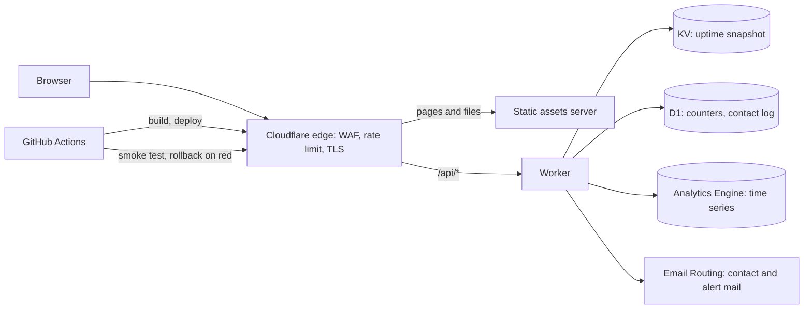

## rozsoshnykh.no

A personal site and blog, built with AI sessions on Cloudflare's free plan.
Live: https://rozsoshnykh.no

It is the portfolio and blog of Dmytro Rozsoshnykh (sysadmin / DevOps,
Norway). The pages are a static Next.js export in Norwegian (`nb-NO`) with an
English twin under `/en/`. A small Worker serves `/api/*`: an uptime monitor,
a visitor map, per-post view counters and a contact form. Almost all of the
code, the posts' tooling and the docs were written in sessions with Claude
Code, and the repository is set up so that such a session can change the site
and ship it without a human reviewing each step. This README explains how it
fits together, what it costs, and how to reuse it. Code and docs are in
English; the site copy is Norwegian first.

### Architecture



- Pages never touch the Worker: they come from the asset server, each with its
  strict hash-based CSP baked in at build (`scripts/finalize-export.mjs`,
  re-checked by `scripts/check-csp.mjs`). A spent Worker quota cannot take the
  pages down.
- The Worker (`src/`) handles `/api/*`, two crons (an uptime probe every five
  minutes, a daily prune of the stored contact messages) and the MTA-STS
  policy.
- Deploys are driven by GitHub Actions: a PR runs `check`, a green PR is
  squash-merged, the merge runs the deploy, a smoke test checks production and
  a red smoke rolls the Worker back.

### What the free plan gives, and what this site spends

Numbers are the ones quoted in this repository's docs (`src/CLAUDE.md`,
`docs/cloudflare-security.md`, `docs/gotchas.md`, `wrangler.jsonc`,
`.github/CLAUDE.md`). Where the docs give no figure the cell says so.

| Resource | Free limit | Used here | How it is kept low |
|---|---|---|---|
| Worker requests | 100,000 per day per account; past it `/api/*` answers 429 | Only `/api/*` and the MTA-STS policy; no figure recorded in the docs | `run_worker_first` runs the Worker for `/api/*` only. Pages, files and misses come from the asset server, which is free and unlimited and keeps working past the quota. Requests the WAF blocks never reach the Worker |
| KV writes | 1,000 per day | The 5-minute uptime snapshot only (288 writes a day at that cadence) | Never a per-request KV write; per-request data goes to D1 or Analytics Engine |
| D1 | 100,000 writes per day; Time Travel restore for 7 days | Small counter and contact tables (`schema/metrics.sql`); no figure recorded | One counted beacon per browser per day, never from automated browsers; atomic upsert counters; contact rows pruned after 30 days |
| Analytics Engine | 100,000 data points per day, 3 months' retention | One point per beacon; no figure recorded | Sampled, append-only; a POST writes at most one point |
| WAF custom rules | 5 rules | 1 ("Block scanners") | One rule with extension, dot-file and word patterns that skip the blog and static prefixes; CI (`scripts/check-waf.mjs`) fails if it would block a served URL |
| Rate limiting rules | 1 rule | 1: 60 requests / 10 s per IP, block | Counts every path except the static prefixes; writes are also capped per address by the Worker's `WRITE_LIMITER` binding (20 per minute) |
| Email Routing | Free | Contact-form mail and outage alerts to the owner's inbox | Turnstile, a honeypot and per-client caps sit in front of every send |
| Turnstile | Free | The contact form | The smoke test checks that a post without a token is refused |
| GitHub Actions | Free minutes for a public repository | CI, deploy, the watchdog and manual ops workflows | Four watchdog runs an hour because GitHub starts only some scheduled runs; the build job holds no secrets |

### Built with AI sessions

The repository is written for agents as much as for people.

- **A map, not a manual.** The root `CLAUDE.md` holds the commands and hard
  rules and points to area files that load only when a task touches that area:
  `app/CLAUDE.md`, `components/CLAUDE.md`, `src/CLAUDE.md`,
  `.github/CLAUDE.md`, `content/CLAUDE.md`. `docs/gotchas.md` covers root
  config, `docs/cloudflare-security.md` the zone, `docs/history.md` the
  incidents behind the rules, and `docs/decisions.md` the owner's standing
  decisions, so a session does not re-propose what was already ruled on.
- **Docs cannot drift.** `scripts/check-docs.mjs` (run by `tests/docs.test.ts`
  and by a Stop hook) fails when a doc names a missing path or when a Worker
  module, `/api/*` route, route directory, workflow, script, skill or hook is
  in no doc.
- **Skills** in `.claude/skills/`: `audit` (a prioritised whole-project
  audit), `new-post` (a Norwegian and English post pair), `ship` (delegate a
  planned change and ship it as one PR), `browser-check` (look at a built page
  in headless Chromium).
- **Hooks** in `.claude/hooks/`: `session-start.sh` installs dependencies,
  `guard-bash.mjs` blocks shell reads of generated files, `stop-docs.mjs` runs
  the docs check before a session ends.
- **Model routing and token economy.** Posts, copy, docs and small UI go to a
  mid-size model; the Worker, CSP, WAF, counters and the deploy pipeline to a
  larger one; a hard bug with no known cause to the largest. Sessions grep
  before reading, read only the part they need, batch calls, and never read
  generated files.
- **Guardrails that make unattended merges safe.** `main` requires the `check`
  status (lint, typecheck, unit tests, then a build with the CSP and WAF
  checks and Playwright browser tests in Chromium and WebKit). A green PR
  squash-merges itself; the deploy then runs `scripts/smoke.sh` against
  production and runs `wrangler rollback` if it fails. A `status-watchdog`
  workflow outside Cloudflare fails, and GitHub e-mails the owner, when the
  site is down, the status snapshot is stale or a read path is degraded.

### Use it as a template

1. `lib/site.ts`: name, roles, titles and colours per language; also replace
   the personal texts in `data/` (skills, certifications, UI copy) and the
   privacy pages in `app/`.
2. `src/contact.ts`: `CONTACT_ADDRESS`, the address shown and used by the
   contact form (and the sender address in `src/index.ts`).
3. `wrangler.jsonc`: the KV and D1 ids, the custom domains and the crons; the
   `d1-bootstrap` workflow creates the D1 database. Create the KV namespace
   and Analytics Engine dataset in your account.
4. Secrets in the GitHub environment `production`: `CLOUDFLARE_API_TOKEN`,
   `CLOUDFLARE_ZONE_TOKEN`, `CLOUDFLARE_ACCOUNT_ID`, `TURNSTILE_SECRET`,
   `NETBOX_URL` (optional; the uptime cron's extra target, see
   `monitors()` in `src/status.ts`), `OWNER_INBOX`, `AE_API_TOKEN`. One
   repository variable: `TURNSTILE_SITE_KEY`. Details in `.github/CLAUDE.md`.
5. `content/`: replace the posts in `content/blog/` and `content/blog/en/`
   (rules in `content/CLAUDE.md`); `data/tags.ts` holds the tag canon.
6. The zone: `zone-rules.yml` and `.github/waf/scanner-block.expr` apply the
   WAF rule and zone settings; `docs/cloudflare-security.md` explains each.
7. Start `robots.index: false` (as here) until you want to be found.

### Local development

```
npm ci
npm run dev        # Next dev server (pages only; /api/* is not served)
npm run check      # lint + typecheck + tests; must pass before a PR
npm run build      # static export to out/, then postbuild finalises it
```

The full list of commands is below. Browser tests need a build:
`NEXT_PUBLIC_TURNSTILE_SITE_KEY=1x00000000000000000000AA npm run build`, then
`npm run test:e2e`.

### Costs

Cloudflare (Workers, KV, D1, Analytics Engine, Email Routing, Turnstile, the
WAF rules) runs on the free plan, and GitHub Actions on a public repository
needs no paid plan. The domain name and the AI subscription used for the
sessions are not free.

### Commands

| | |
|--|--|
| `npm run dev` | Next dev server with Turbopack |
| `npm run build` | `prebuild` emits `public/world.svg`, then static export to `out/`, then `postbuild` (`scripts/finalize-export.mjs`): each page's hash CSP `<meta>`, `lang="en"`, `/favicon.ico`, slash-less 301s |
| `npm run check:waf` / `check:csp` | After a build: the WAF rule blocks no served URL (`scripts/check-waf.mjs`); every inline script is hashed in its page's CSP (`scripts/check-csp.mjs`) |
| `npm run lint` | ESLint (flat config, `next/core-web-vitals` + `next/typescript`) |
| `npm run typecheck` | `wrangler types --check` (`cf-typecheck`: is `worker-configuration.d.ts` current?), then `tsc --noEmit` for app **and** worker (`tsconfig.worker.json`) |
| `npm test` | Vitest — CSP hashing + violation-report parsing, status history + alert damping + staleness, tags, metrics, contact, reading time, page metadata, map buckets, time-series (epoch boundary, AE parsing, bucket fill), and the Worker route handlers (`tests/worker/`, D1 as real SQLite) |
| `npm run test:e2e` | After a build: Playwright browser tests (`e2e/`, `playwright.config.ts`) on `out/` served by `scripts/serve-out.mjs`, `/api/*` stubbed — user flows, axe in both themes, no console error or CSP violation (CI runs them) |
| `npm run cf-typegen` | Regenerate `worker-configuration.d.ts` from `wrangler.jsonc` |
| `npm run deploy` | Manual path: `predeploy` (lint + typecheck + test) → build → `wrangler deploy` |

### CI/CD

Push to `main` runs `.github/workflows/deploy.yml`: a secret-free build job
(lint, typecheck, test, build, `wrangler deploy --dry-run`, `check:waf`,
`check:dict`, `check:csp`), then a deploy job with the `production`
environment's secrets: sync runtime secrets, `npx wrangler deploy`,
`scripts/smoke.sh` against production (pages, APIs, redirects, security
headers, live CSPs, caching, noindex). A failed smoke rolls the Worker back.
`ci.yml` runs the same gate plus the Playwright tests on PRs as the `check`
status. PRs open ready with squash auto-merge; to hold one, open a draft.
Monitoring and one-shot ops workflows (`status-watchdog`, `analytics-report`,
`d1-bootstrap`, `d1-repair`, `reset-metrics`, `zone-rules`) are described in
`.github/CLAUDE.md`. There is no off-platform backup: D1 Time Travel is the
only restore path, an accepted risk since the counters are cosmetic and
contact messages are delivered by e-mail anyway.

### Repository layout

```
.claude/            Claude Code project config: skills (audit, browser-check,
                    new-post), hooks (session-start.sh: npm ci; guard-bash.mjs:
                    no shell reads of generated files; stop-docs.mjs: doc-drift
                    gate before a session ends), permissions allowlist
app/                Next App Router: home, /blogg, /blogg/tag/[slug], /kontakt,
                    /personvern, en/ (English home, contact, privacy, blog,
                    feed and OG cards), feed.xml, sitemap, robots, manifest, OG
                    images, icons/[name] (PNG icons), error boundaries,
                    template.tsx (opacity route cross-fade)
components/         React components (Hero, Skills, StatusDashboard, GeoMap,
                    HalIdle, ContactForm, Turnstile, …)
content/blog/       Markdown posts (frontmatter: title, description, date, tags;
                    checked by lib/post-frontmatter.ts); English twins in
                    content/blog/en/ (translationOf)
content/diagrams/   Post diagram sources (SVG with live text), built into
                    public/images/ by scripts/build-diagrams.mjs
context/            ThemeContext (light/dark with no FOUC)
data/               Skills, certifications, tag canon + aliases (tags.ts), UI
                    copy in both languages (i18n.ts; the error boundary's in
                    i18n-error.ts)
docs/               history.md — incident history, the "why" behind CLAUDE.md's
                    hard rules; cloudflare-security.md — the zone's edge
                    security on the Free plan; decisions.md — the owner's
                    standing decisions; gotchas.md — root-config rules
                    (agent docs: CLAUDE.md map, app/CLAUDE.md pages,
                    components/CLAUDE.md front end, src/CLAUDE.md worker,
                    .github/CLAUDE.md workflows, content/CLAUDE.md blog)
lib/                blog.ts, tags.ts, markdown.ts, reading-time.ts, clipboard.ts,
                    stars.ts, fonts.ts (the self-hosted body font), site.ts
                    (name/roles/titles/colours per language),
                    metadata.ts (pageMetadata), i18n.ts + use-lang.ts (NO/EN
                    paths and language), blog-paths.ts, feed.ts (RSS per
                    language), og-site-card.tsx, og-post-card.tsx, og-fonts.ts
                    (Intel One Mono for the OG cards), geo.ts,
                    post-images.ts (post images: size, lazy, build checks),
                    post-frontmatter.ts (a post's frontmatter, checked on read),
                    inline-code.ts (inline code breaks between words only),
                    status-fetch.ts (one shared /api/status fetch),
                    server-clock.ts (the widgets' "now", from the API's Date
                    header, not the visitor's clock),
                    use-near-viewport.ts (below-the-fold widgets load on
                    approach), timeseries-fill.ts, trends-axis.ts, visit.ts
schema/             metrics.sql (views, geo, contact)
scripts/            smoke.sh, build-world-svg.mjs, finalize-export.mjs
                    (postbuild), check-csp.mjs, check-waf.mjs, check-docs.mjs
                    (docs drift), serve-out.mjs (out/ for the browser tests),
                    build-diagrams.mjs (post diagrams: npm run diagrams),
                    mcp.mjs (read-only Webhuset + Cloudflare API tools, on demand)
src/                Cloudflare Worker for /api/* + MTA-STS (index.ts, csp.ts, http.ts,
                    ip.ts, status.ts, metrics.ts, contact.ts, timeseries.ts,
                    routes/*)
tests/              Vitest
e2e/                Playwright browser tests (site.e2e.ts, fixtures.ts,
                    api-stub.ts: the Worker's answers, held to the route
                    handlers by tests/worker/api-stub.test.ts)
wrangler.jsonc      Worker config (ASSETS, STATUS KV, METRICS D1, METRICS_AE,
                    WRITE_LIMITER, CONTACT_EMAIL, crons, custom domains: apex,
                    www, mta-sts)
```

### More detail

`CLAUDE.md` (the map), `app/CLAUDE.md` (pages, i18n, metadata, SEO),
`components/CLAUDE.md` (front end), `src/CLAUDE.md` (the Worker and its API),
`.github/CLAUDE.md` (CI/CD and ops), `content/CLAUDE.md` (the blog),
`docs/gotchas.md` (root config), `docs/decisions.md` (the owner's decisions)
and `docs/cloudflare-security.md` (the zone). Manual deploy, from a machine
with `wrangler login` and your own ids in `wrangler.jsonc`: `npm run deploy`.

### Licence

The code is MIT (`LICENSE`). The blog posts under `content/`, the images and
the personal texts (name, bio, privacy notices) are (c) Dmytro Rozsoshnykh,
all rights reserved.
