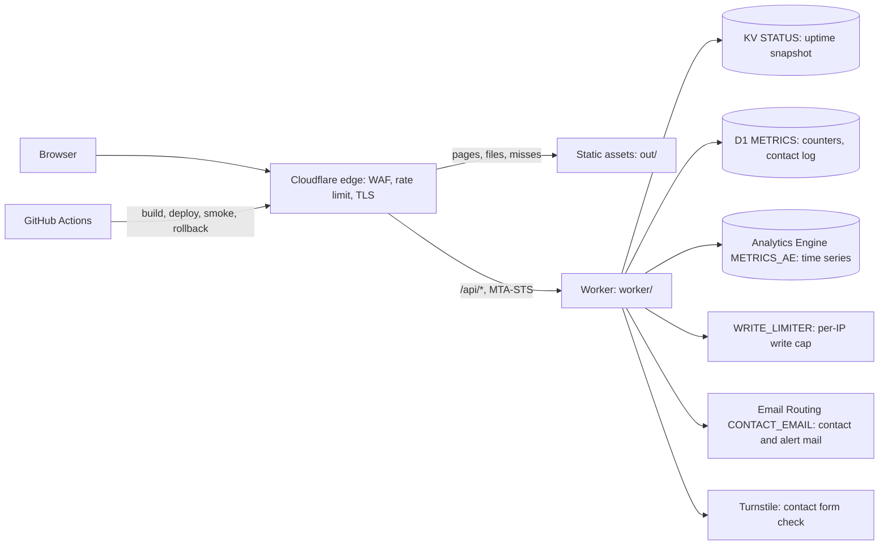

# Architecture

A static Next.js export served by Cloudflare's asset server, plus a small
Worker that runs only for `/api/*` and the MTA-STS policy
(`assets.run_worker_first` in `wrangler.jsonc`). Pages never touch the Worker,
so a spent Worker quota cannot take them down.

Bindings are declared in `wrangler.jsonc` (`ASSETS`, `STATUS`, `METRICS`,
`METRICS_AE`, `WRITE_LIMITER`, `CONTACT_EMAIL`; two crons: an uptime probe
every five minutes and a daily prune of stored contact messages). Turnstile is
an HTTP call from `worker/domain/contact.ts`, not a binding. There is no R2.

## Directories

| Path | Owns |
|---|---|
| `app/` | Next App Router pages and routes (Norwegian at the root, `app/en/`), metadata, feeds, OG cards |
| `components/`, `context/` | React widgets (status, map, trends, contact form), theme |
| `lib/`, `data/` | Helpers split by where they run (`lib/server/` build/export only, `lib/client/` browser, `lib/shared/` pure, also imported by the Worker); copy, skills, tag canon |
| `content/` | Blog posts (Markdown; English twins in `content/blog/en/`), diagram sources |
| `worker/` | The Worker: `index.ts` dispatches to `worker/routes/*` (HTTP only), which call `worker/domain/*` (rules; `*-store.ts` hold the bindings); CSP, the `/api/*` contract |
| `schema/` | D1 schema (`metrics.sql`) |
| `scripts/` | Build finalisation, CSP/WAF/docs checks, smoke test, read-only API tools |
| `tests/`, `e2e/` | Vitest (Worker handlers on real SQLite) and Playwright browser tests |

Who may import whom between these (the app never reaches into `worker/` but for the `api-types.ts` types; `worker/` takes only `lib/shared/`; browser code never takes `lib/server/`) is enforced by ESLint (`eslint.config.mjs`), not by this page.
| `.github/` | CI, deploy, monitoring and one-shot ops workflows, zone rules |
| `.claude/` | Agent config: skills, hooks, permissions |
| `docs/` | Decisions, incident history, gotchas, edge security |

`node scripts/check-docs.mjs --map` prints every module with its purpose line.
Scripts share `scripts/cli.mjs` (`usage:` on bad arguments, a one-line reason
and exit 1 on failure) and name no host of their own: the origin is
`lib/shared/site.ts`, which `scripts/smoke.sh` reads through `scripts/site-env.mjs`.

## Two languages

Each page exists twice: a Norwegian route and an English route under
`app/en/`, both thin wrappers over the same components, with strings from
`data/i18n.ts`. `lib/shared/i18n.ts` maps paths to the language and pairs the twins;
`pageMetadata` (`lib/shared/metadata.ts`) emits hreflang. A post names its Norwegian
twin in `translationOf`. After the build, `scripts/finalize-export.mjs`
bakes each page's hash-based CSP `<meta>`, the `lang` attribute and the
redirects into `out/`. Nothing redirects by browser language; the NO/EN switch
is the only way across.

## Build and deploy

PR → `ci.yml` (`check`: lint, typecheck, tests, build, CSP/WAF checks,
Playwright) → squash auto-merge → `deploy.yml` (secret-free build job, then
`wrangler deploy`, `scripts/smoke.sh`, `wrangler rollback` on a red smoke).
`status-watchdog.yml` probes production from outside Cloudflare.

## Where the rules live

The root `CLAUDE.md` holds commands and hard rules and maps the rest: one
`CLAUDE.md` per area (`app/`, `components/`, `worker/`, `.github/`, `content/`),
and `docs/`: `gotchas.md` (root config), `decisions.md` (the owner's standing
decisions), `history.md` (incidents behind the rules),
`cloudflare-security.md` (the zone). Skills in `.claude/skills/` (`audit`,
`browser-check`, `new-post`, `pr-flow`, `ship`) and hooks in `.claude/hooks/`
(`session-start.sh` installs dependencies, `guard-bash.mjs` blocks shell reads
of generated files, `stop-docs.mjs` runs the docs check before a session ends).
`scripts/check-docs.mjs` keeps the docs from drifting: a doc naming a missing
path, an undocumented route, workflow, skill or hook, or a source file without
a purpose header fails `npm test`.
